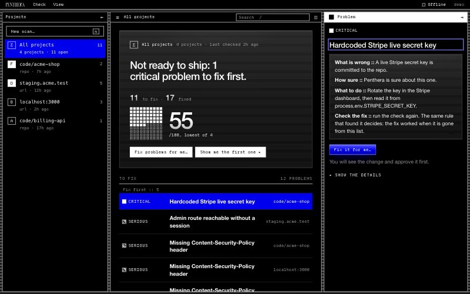
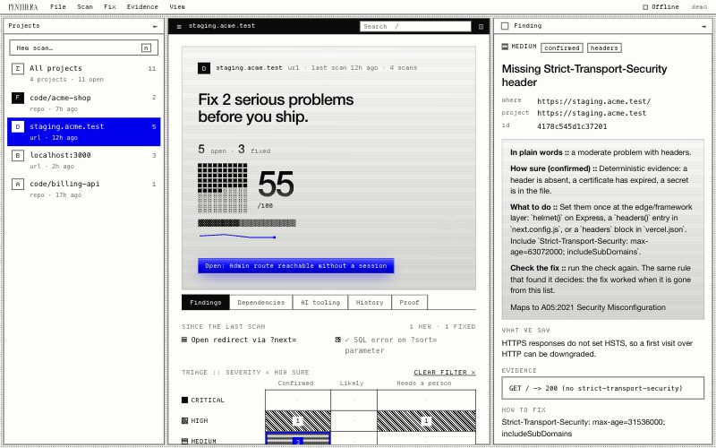
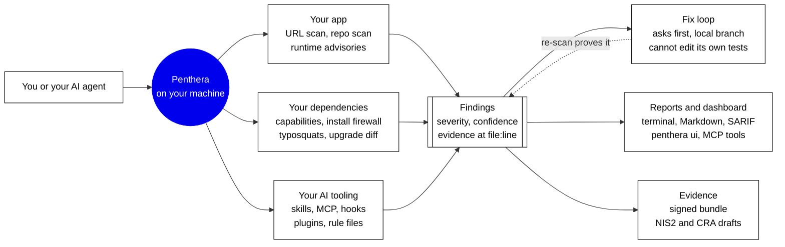

<div align="center">


<br/><br/>

# Penthera: your open-source cyber security agent

The security review you never had time for. Offline, rule-based, and you can verify every finding yourself.

**[penthera.org](https://penthera.org)**: check your live site in a few seconds. Passive, nothing stored.

Daily notes from Penthera: **[x.com/penthera_org](https://x.com/penthera_org)**

**132** readable rules · **6** read-only MCP tools · **1** runtime dependency · **0** requests past loopback in the benchmark · **MIT**, no telemetry

<br/>

[](https://www.npmjs.com/package/penthera)
[](https://www.npmjs.com/package/penthera)
[](https://github.com/danoszz/penthera/stargazers)


[](https://github.com/danoszz/penthera/actions/workflows/ci.yml)
[](https://scorecard.dev/viewer/?uri=github.com/danoszz/penthera)

<br/>


<br/><br/>

| `penthera ui`, Simple, dark | `penthera ui`, Advanced, light |
|---|---|
|  |  |

</div>

---

## What it is

Penthera checks your app, its dependencies and your AI coding tools on your own
machine. It fixes what it can, with your approval. Every finding comes from a
rule you can read, with its evidence at `file:line`. A model may propose; a rule
decides.

It is also an open R&D project. We measure every check in public and publish
the results, good or bad, so you can see how far to trust it.

It finds known classes of problems, not novel ones. It does not replace a human
pentester.

## Start in 30 seconds

You need Node.js 22 or later. No install, no account.

Building with Cursor, Claude Code, Codex, VS Code, Windsurf, Gemini CLI, Zed,
JetBrains or Kiro, or an app builder such as Lovable, Bolt, Base44, Replit or
v0? [Penthera in your coding tool](docs/integrations.md) has the setup for
each.

**In your terminal.** Run this in your project folder:

```bash
npx penthera
```

It detects your setup offline, asks what to check, and gives you a grade per
area and the three things to fix first. It scans your running app only after
you confirm the app is yours. Nothing is committed or pushed
([guided start](docs/commands/init.md)).

**In your coding agent, as a skill.** Then ask "scan my app for security
issues":

```bash
npx skills add danoszz/penthera
```

**In your coding agent, as an MCP server.** Six read-only tools for Claude Code,
Cursor, Codex, VS Code and Windsurf. Pin the version:

```bash
claude mcp add penthera -- npx -y penthera@2.1.2 mcp
```

**In Claude Code, as a plugin.** From Claude Code's prompt:

```
/plugin marketplace add danoszz/penthera
/plugin install penthera@penthera
```

**In Gemini CLI, as an extension.** It runs the MCP server pinned in
[`gemini-extension.json`](gemini-extension.json), which follows the newest
release, release candidates included:

```bash
gemini extensions install https://github.com/danoszz/penthera
```

Other clients: [docs/commands/mcp.md](docs/commands/mcp.md). Other skill install
routes: [docs/commands/skill.md](docs/commands/skill.md).

To run it in a container:
`docker build -t penthera . && docker run --rm penthera https://your-app.example`.

## Public benchmarks

We test Penthera on public datasets that other people built, next to the free
open-source tools that do the same job, scored the same way. Each dataset was
split in half before we looked: we improved Penthera on one half and scored it
once on the other, sealed half. The rules for scoring and ranking were written
down before that run ([protocol](docs/research/prereg/E11b-improvement-study.md)).

<!-- public-benchmarks:start -->
| Benchmark | Score | Penthera 1.9.0 | **Penthera 2.0.0** | Rank among free tools | Best other free tool |
|---|---|---|---|---|---|
| [Leaked secrets (Samsung CredData)](https://penthera.org/benchmarks/secrets) | F1 | 0.18 | **0.74** | **2nd of 10** | deepsecrets 0.78 |
| [Malicious npm packages (DataDog)](https://penthera.org/benchmarks/npm-malware) | caught minus false alarms | 0.57 | **0.71** | **1st of 6, tied 1st to 3rd** ⁴ | malcontent 0.63 |
| [Malicious PyPI packages (DataDog)](https://penthera.org/benchmarks/pypi-malware) | caught minus false alarms | 0.74 | **0.82** | **1st of 8, tied 1st to 3rd** ⁴ | GuardDog 0.74 |
| [Injection bugs in JS libraries (SecBench.js)](https://penthera.org/benchmarks/js-injection) | found in the right file | 0.16 | **0.70** | **1st of 8, tied 1st to 4th** ⁴ | odgen 0.68 |

⁴ A tied range is a rank interval: the range Penthera's rank fell in, in 95% of 10,000 bootstrap redraws of each tool's counts (on SecBench.js, of its 64 test bugs). Penthera alone came out first in 76% of the redraws on npm, 82% on PyPI and 60% on SecBench.js. Exploratory: computed after the registered ranking.

Leaked secrets: 2nd by F1, the registered score; 1st by F0.5, which weighs precision more (0.82 against deepsecrets 0.80); 2nd by F2, which weighs recall more (0.68 against deepsecrets 0.77).

Some ranked tools are barely in the contest. Other ranked tools scoring below 0.10: 1 of 9 on CredData (trufflehog); 3 of 5 on npm (clamav, yara, ossgadget); 4 of 7 on PyPI (clamav, ossgadget, bandit4mal, aura); 1 of 7 on SecBench.js (njsscan).

If 1 package in 1,000 were malicious, the share of Penthera's malware flags that would be right: npm, about 2.7% at the top of the false-alarm interval (it raised no false alarm on that sample); PyPI, about 1.6% at the measured false-alarm rate, 0.9% at the top of its interval. Exploratory, like the rank intervals.

<details><summary>Every tool, every number (95% intervals)</summary>

#### Leaked secrets (Samsung CredData)

| Rank | Tool | Precision | Recall | F1 |
|---:|---|---|---|---|
| 1 | deepsecrets 2.2.0 | 0.80 [0.79, 0.82] | 0.77 [0.75, 0.78] | 0.78 |
| 2 | **Penthera** 2.0.0 | 0.89 [0.87, 0.90] | 0.64 [0.62, 0.66] | 0.74 |
| 3 | noseyparker 0.24.0 | 0.76 [0.74, 0.78] | 0.62 [0.60, 0.64] | 0.69 |
| 4 | gitleaks 8.30.1 | 0.85 [0.84, 0.86] | 0.37 [0.35, 0.39] | 0.52 |
| 5 | ripsecrets 0.1.11 | 0.65 [0.64, 0.67] | 0.35 [0.33, 0.37] | 0.45 |
| 6 | kingfisher 2.14.0 | 0.96 [0.94, 0.97] | 0.29 [0.28, 0.31] | 0.45 |
| 7 | detect-secrets 1.5.0 | 0.30 [0.29, 0.31] | 0.53 [0.51, 0.56] | 0.38 |
| 8 | secretlint 13.0.7 | 0.92 [0.89, 0.94] | 0.19 [0.18, 0.21] | 0.32 |
| 9 | whispers 2.4.0 | 0.46 [0.43, 0.50] | 0.09 [0.08, 0.10] | 0.15 |
| 10 | trufflehog 3.99.3 | 0.40 [0.35, 0.45] | 0.05 [0.05, 0.07] | 0.10 |
| – | credsweeper 1.19.4 ¹ | 1.00 [1.00, 1.00] | 0.98 [0.98, 0.99] | 0.99 |
| – | Penthera 1.9.0 | 0.56 [0.51, 0.60] | 0.10 [0.09, 0.12] | 0.18 |
| | Free tools, mean / median | 0.68 / 0.76 | 0.36 / 0.35 | 0.43 / 0.45 |

#### Malicious npm packages (DataDog)

| Rank | Tool | Caught | False alarms on benign packages | Caught minus false alarms |
|---:|---|---|---|---|
| 1 | **Penthera** 2.0.0 | 0.71 [0.62, 0.78] (79/112) | 0.00 [0.00, 0.02] (0/150) | 0.71 |
| 2 | malcontent 1.27.1 (bf280ad6), yara-x 1.21.0 | 0.68 [0.59, 0.76] (76/112) | 0.05 [0.03, 0.10] (8/150) | 0.63 |
| 3 | GuardDog 3.2.0 ² | 0.62 [0.52, 0.70] (69/112) | 0.03 [0.01, 0.07] (4/150) | 0.59 |
| 4 | ossgadget 0.2.20 (414b6a59) | 0.94 [0.88, 0.97] (105/112) | 0.89 [0.83, 0.93] (133/150) | 0.05 |
| 5 | clamav 1.5.4 | 0.01 [0.00, 0.05] (1/112) | 0.00 [0.00, 0.02] (0/150) | 0.01 |
| 6 | yara yara-python 4.5.4 (YARA 4.5), YARA-Forge core 20261004 | 0.00 [0.00, 0.03] (0/112) | 0.00 [0.00, 0.02] (0/150) | 0.00 |
| – | osv-scanner 2.6.0 ³ | 0.90 [0.83, 0.94] (101/112) | 0.01 [0.00, 0.04] (1/150) | 0.90 |
| – | Penthera 1.9.0 | 0.57 [0.48, 0.66] (64/112) | 0.00 [0.00, 0.02] (0/150) | 0.57 |

#### Malicious PyPI packages (DataDog)

| Rank | Tool | Caught | False alarms on benign packages | Caught minus false alarms |
|---:|---|---|---|---|
| 1 | **Penthera** 2.0.0 | 0.87 [0.81, 0.92] (131/150) | 0.05 [0.03, 0.10] (8/150) | 0.82 |
| 2 | GuardDog 3.2.0 ² | 0.85 [0.79, 0.90] (128/150) | 0.11 [0.07, 0.17] (16/147) | 0.74 |
| 3 | malcontent 1.27.1 (bf280ad6), yara-x 1.21.0 | 0.93 [0.87, 0.96] (139/150) | 0.22 [0.16, 0.29] (32/147) | 0.71 |
| 4 | yara yara-python 4.5.4 (YARA 4.5), YARA-Forge core 20261004 | 0.25 [0.18, 0.32] (37/150) | 0.00 [0.00, 0.03] (0/147) | 0.25 |
| 5 | clamav 1.5.4 | 0.00 [0.00, 0.02] (0/150) | 0.00 [0.00, 0.03] (0/147) | 0.00 |
| 6 | ossgadget 0.2.20 (414b6a59) | 0.77 [0.70, 0.83] (116/150) | 0.97 [0.93, 0.99] (143/147) | -0.20 |
| 7 | aura 2.1 (SourceCode-AI/aura b40e6dd2) | 0.59 [0.51, 0.67] (88/149) | 0.83 [0.75, 0.88] (100/121) | -0.24 |
| 8 | bandit4mal lyvd/bandit4mal 03ba95f3 (bandit 1.6.3 fork) | 0.59 [0.51, 0.67] (89/150) | 0.84 [0.78, 0.89] (124/147) | -0.25 |
| – | Penthera 1.9.0 | 0.83 [0.77, 0.88] (125/150) | 0.09 [0.06, 0.15] (14/150) | 0.74 |
| – | osv-scanner 2.6.0 ³ | 0.74 [0.66, 0.80] (110/149) | 0.00 [0.00, 0.03] (0/147) | 0.74 |

#### Injection bugs in JavaScript libraries (SecBench.js)

| Rank | Tool | Command injection | Code injection | Both |
|---:|---|---|---|---|
| 1 | **Penthera** 2.0.0 | 35/47 | 10/17 | 0.70 [0.58, 0.80] |
| 2 | odgen c5157ee | 36/46 | 6/16 | 0.68 [0.55, 0.78] |
| 3 | codeql 2.27.2 (used under the GitHub CodeQL terms, for research on open-source code) | 37/47 | 4/17 | 0.64 [0.52, 0.75] |
| 4 | eslint-plugin-security 4.2.0 | 32/47 | 9/17 | 0.64 [0.52, 0.75] |
| 5 | semgrep 1.180.0 | 15/47 | 9/17 | 0.38 [0.27, 0.50] |
| 6 | graudit 849d7c7 | 12/47 | 10/17 | 0.34 [0.24, 0.47] |
| 7 | bearer 2.1.1 | 14/47 | 0/17 | 0.22 [0.14, 0.33] |
| 8 | njsscan 1.0.1 | 2/45 | 1/15 | 0.05 [0.02, 0.14] |
| – | semgrep, every file 1.180.0 (another setting of semgrep, not ranked) | 16/47 | 9/17 | 0.39 [0.28, 0.51] |
| – | Penthera 1.9.0 | 0/47 | 10/17 | 0.16 [0.09, 0.26] |

A rank is shown only where at least 5 other free tools were measured; otherwise "–". The rank column orders tools by score, and close scores can swap places. Penthera's 95% rank interval (bootstrap, exploratory): 2nd on CredData, 1st to 3rd on npm, 1st to 3rd on PyPI, 1st to 4th on SecBench.js.

Paid tools (GitGuardian, Socket, Snyk, Phylum, Semgrep Pro) publish no results on these benchmarks, so they are not in the tables.

Published elsewhere, on other datasets (context, not comparable):

- [A comparative study of software secrets reporting by secret detection tools (2023): nine tools on SecretBench, ggshield included](https://arxiv.org/abs/2307.00714)
- [How effective are npm malicious package detectors? (2026): eleven detectors on their own benchmark](https://arxiv.org/abs/2603.27549)
- [Cutting the Gordian knot: detecting malicious PyPI packages (USENIX Security 2026): GuardDog, Bandit4Mal and OSSGadget on PyPI](https://arxiv.org/abs/2601.16463)
- [Study of JavaScript static analysis tools for vulnerability detection in Node.js packages (2023): nine tools incl. CodeQL, NodeJsScan, ODGen](https://www.researchgate.net/publication/367088656)

¹ Not ranked: trained on this dataset by its authors. ² Found most samples in this dataset, so its rate is inflated by construction. ³ Not ranked: a lookup of already-reported packages, not detection.

</details>
<!-- public-benchmarks:end -->

What these numbers do not show: a benchmark is not your code. CredData replaces
real secrets with look-alikes, which favors pattern rules like ours over tools
that verify keys; the free tools ran on their defaults while Penthera was tuned
on the other half; GuardDog helped build the malware dataset. Accuracy on real
projects is experiment E1. Reproduce every table with
`npm run bench:public -- --split test --final` and
`npm run bench:public -- --competitors --split test --final`.

## What it does



### Before you deploy

| Job | What Penthera does | Command |
|---|---|---|
| Test the app | Scans your localhost or preview URL (TLS, headers, CORS, cookies, auth, JWT, IDOR, OAuth, OpenAPI; injection and fuzzing only when you ask, after a confirmation) and your repository (routes, trust boundaries, code-execution sinks, secrets including AI keys) | [`penthera <url> --repo .`](docs/commands/scan.md) |
| Check your runtimes | Whether the PHP, nginx, Apache, Node.js, Python, OpenSSL or MongoDB version you run is affected by a known advisory, from the signed advisories pack | [Runtime advisories](docs/runtime-advisories.md) |
| Fix and verify | Applies deterministic fix recipes on a local branch, re-scans to prove they worked, and remembers the result. Never pushes | [`penthera agent --loop`](docs/commands/fix.md) |
| Block it at commit time | Stops secrets, risky agent config and dependency changes before they are committed | [`penthera hook install`](docs/commands/hook.md) |

### What you build with

| Job | What Penthera does | Command |
|---|---|---|
| Vet dependencies | Shows what every npm and Python package can do (install scripts, shell, network, env, obfuscation), what an upgrade added, lookalike names and licenses | [`penthera deps --base main`](docs/commands/deps.md) |
| Guard installs | Shows what a new package brings before any install script runs, and stops it under your policy | [`penthera install <pkg>`](docs/commands/install.md) |
| Review pull requests | Comments the dependency capability diff on every PR that touches the lockfile | [GitHub Action](docs/commands/action.md) |
| Audit your AI tooling | Checks skills, MCP servers, hooks, plugins and rule files for hidden instructions, unpinned servers, over-broad permissions and silent updates | [`penthera agents --home`](docs/commands/agents.md) |
| Work from your agent | Six read-only MCP tools: scan the repo, check dependencies, audit AI tooling, runtime advisories, explain a finding, a passive URL scan | [`penthera mcp`](docs/commands/mcp.md) |

### After you ship

| Job | What Penthera does | Command |
|---|---|---|
| Report and prove | Writes reports for developers, owners and auditors; a hashed, signable evidence bundle; NIS2 and CRA readiness reports and drafts | [`penthera <url> --audience auditor --evidence out/`](docs/evidence.md) |
| See it all | A local dashboard on 127.0.0.1. Simple mode for non-programmers: a one-sentence verdict, problems in plain words, and a check-and-fix mode with Apply, Skip and Stop per change. Advanced adds dependencies, AI tooling, history and evidence | [`penthera ui`](docs/dashboard.md) |
| Keep watching | Scheduled checks of production for drift: certificates, headers, new endpoints, keys in bundles, new CVEs in your SBOM | on the [roadmap](ROADMAP.md) |

Every finding carries a severity, a confidence label (`confirmed`, `likely`,
`potential`, `needs-human-review`), its evidence and the research behind it.
Reports come out as Markdown, JSON and SARIF for GitHub code scanning. Exit
code `1` means critical or high findings. Every command and flag is in
[docs/commands/](docs/commands/README.md). Compliance output is readiness
tooling, not a certification and not legal advice.

**AI mode (opt-in).** `penthera --repo . --ai` lets a local model
propose problems no rule describes. Penthera checks each proposal with its
rules, and anything unconfirmed is labelled "model-proposed, unverified" and
never fails CI. Whether it finds more than the rules alone is not measured yet
([AI mode](docs/ai-mode.md)).

### How far each part has been taken

| Part | Status |
|---|---|
| Scans: URL, repo, dependencies, AI tooling, installs, pre-commit hook | **Stable**: in every release since 1.x, covered by the tests and the release gate |
| Fix loop and local dashboard (`penthera ui`) | **Stable**; the dashboard was redesigned in 1.9.0 |
| MCP server, Agent Skill, Claude Code plugin | **Stable**, since 1.9.0 |
| Gemini CLI extension | **Stable**: it installs the newest release (2.1.2) |
| Evidence bundles, NIS2 and CRA drafts | **Stable** as readiness tooling, not a certification |
| AI mode (`--ai`) | **Experimental**: whether it finds more than the rules alone is not measured yet ([AI mode](docs/ai-mode.md)) |
| Live check on [penthera.org](https://penthera.org) | **Beta**: passive only, [terms](docs/live-check-terms.md) |

## How it is measured

Each feature goes through the same path: **method → evidence → tool.**

- **Method.** The [methodology](docs/METHODOLOGY.md) states the threat model,
  what black-box (HTTP) and white-box (source) analysis can and cannot see, the
  confidence model, and the false-positive controls on each probe. Each design
  choice cites the research or standard it rests on: 95 verified references, in
  APA style, in [docs/references.md](docs/references.md).
- **Evidence.** A benchmark runs on every release, and the release gate fails
  if precision or recall drops by more than 0.02. Experiments that decide what
  ships next are pre-registered in [docs/research/prereg/](docs/research/prereg/)
  before any data is collected, and the results are published either way.
- **Tool.** What holds up ships in a reviewed, signed release. What does not
  hold up is dropped, and the rules stay.

| Measure | Result | Sample |
|---|---|---|
| Precision, bundled benchmark | 0.92, 95% CI 0.74 to 0.98 | 22 true and 2 false positives |
| Recall, bundled benchmark | 0.96, 95% CI 0.79 to 0.99 | 1 miss, [explained](bench/RESULTS.md) |
| Requests past loopback during the benchmark | 0 | Enforced by a network guard |
| Public benchmarks (E11b), sealed test half | 1st on npm and PyPI malware (tied 1st to 3rd), 1st on JS library injection bugs (tied 1st to 4th), 2nd on leaked secrets | 4 public datasets, up to 10 free tools each ([results](bench/public/RESULTS.md#e11b-final-the-sealed-test-half-scored-once-2026-10-25), [summary](#public-benchmarks)) |
| E10 pilot, known-vulnerable apps | Precision 0.88, 95% CI 0.78 to 0.93. Recall 0.07 before fixes, 0.71 (CI 0.45 to 0.88) after | 14 root causes in Juice Shop and DVNA ([results](bench/known-vuln/RESULTS-after-fixes.md)) |
| Detection rules, all readable | 132 in this release: 16 URL scan templates, 21 secret and AI-key patterns, 15 dependency capabilities, 39 AI-tooling rules, 5 fix recipes, and the signed rule packs | [Rule packs](docs/rule-packs.md) |

The bundled benchmark is 24 findings in small labs we wrote ourselves. It
catches regressions; it does not measure real-world accuracy. The E10 pilot
used one labeller and is not independent: the fixes were written after seeing
the misses on the same two apps. On WebGoat, held out, recall stayed at 2 of 9.
Accuracy on real projects is experiment E1, pre-registered and not yet run.
Intervals are Wilson. What Penthera cannot see is listed under
[Known limitations](docs/METHODOLOGY.md#known-limitations). Refresh the counts
with `npm run docs:numbers` and `npm run bench`.

**Cite this repository** with the button on GitHub or
[CITATION.cff](CITATION.cff). APA and BibTeX forms are in the
[methodology](docs/METHODOLOGY.md#how-to-cite).

## Why you can trust it

- **Local and offline.** No account, no telemetry, no cloud. `--offline` limits
  network traffic to the target you named, and every report lists the hosts it
  contacted ([network use](docs/privacy.md)).
- **Tested unplugged.** Repo scans, `agents`, `deps`, `brief`, evidence
  bundles and URL scans with `--offline` made no outside connections. They
  gave the same result twice, and the same with the network blocked, on macOS
  and Ubuntu ([E17 results](bench/offline/RESULTS.md)). The test can't watch
  `git`, which Penthera uses only for local commands.
- **Deterministic.** Rules you can read, with `file:line` evidence. A model may
  propose a fix or a lead; a deterministic re-scan and your tests decide.
- **Non-destructive by default.** Default scans send no attack payloads.
  Payload testing (`--deep`, `--fuzz`, `--all`) is opt-in, asks for a
  confirmation bound to the target, and is rate-limited.
- **Asks before it changes anything.** The fix loop works on a local branch,
  asks before every change by default, and never pushes or opens pull requests.
- **No update channel to hijack.** Detection rules ship inside reviewed
  releases as signed, versioned [rule packs](docs/rule-packs.md). You can add
  your own by path (`--rules <dir>`). Nothing is downloaded and run at run time.
- **Releases you can verify.** npm provenance through trusted publishing, a
  maintainer approval with 2FA for every version, SHA-pinned CI, CodeQL and
  OpenSSF Scorecard. Every release passes an
  [internal audit](docs/internal-audit.md) of eight gates
  ([latest report](audit/REPORT.md)).

**Verify it yourself.** In an empty folder:

```bash
npm install penthera@2.1.2 && npm audit signatures
npx penthera@2.1.2 rules list
```

The first checks npm's registry signature and the build provenance of the
package you got. The second lists every bundled rule pack and the key that
signed it; a pack whose signature does not verify is refused unless you pass
`--allow-unsigned-rules`.

Penthera finds known classes of problems, not novel ones, and it does not
replace a human pentester or incident response. The decisions behind it, its
limits, and how to challenge them are in the [manifesto and FAQ](docs/MANIFESTO.md).

## How it fits with other tools

Penthera works next to the tools you already use; its SARIF output goes
straight into GitHub code scanning, for example. Each comparison page says where
the other tool goes further and how to run the two together.

| | Focus | Where it runs | How it decides |
|---|---|---|---|
| **Penthera** | Your app, dependencies and AI tooling; fixes; EU evidence | Your machine or CI, offline | Readable deterministic rules, with evidence |
| [Socket](docs/compare/socket.md) | Supply-chain risk across package registries | Cloud service, GitHub App, CLI | Registry-scale package analysis, including AI review |
| [Snyk](docs/compare/snyk.md) | Known vulnerabilities in dependencies, code, containers, IaC | Cloud service, IDE, CLI | Curated vulnerability database plus static analysis |
| [GitHub Dependabot and code scanning](docs/compare/github.md) | Known-CVE alerts, update PRs, CodeQL | GitHub | Advisory database, CodeQL queries |
| [OWASP ZAP](docs/compare/zap.md) | Dynamic testing of web apps | Your machine or CI | Active and passive scan rules |
| [Semgrep](docs/compare/semgrep.md) | Static analysis of your own code | Your machine, CI, cloud platform | Pattern rules, plus a paid cross-file engine |

All comparisons, including Cloudflare's security-audit skill: [docs/compare/](docs/compare/README.md).

### Run the free tools you already have: `--giants`

`--giants` (2.1 release candidate) runs the free scanners installed on your
machine after Penthera's own scan: gitleaks, TruffleHog, Semgrep with your
local rules, osv-scanner, Trivy and Checkov for a repository, nuclei and the
ZAP baseline for a URL. Their findings go into the same report and SARIF, each
labelled with the tool, its version and its rule. Nothing is downloaded or
uploaded, and an area that neither Penthera's rules nor another tool reached
is reported as "not covered".

```bash
penthera giants              # which tools you have
penthera --repo . --giants   # Penthera, then each installed tool
```

This runs the tools you have and merges their findings. Whether the
combination finds more is measured by experiment E14 and is not claimed until
it is published. Details, safety rules and the policy key:
[docs/commands/giants.md](docs/commands/giants.md).

## Start here

| You want to know | Read |
|---|---|
| Is my app safe to ship? | [I'm new](docs/index.md#1-im-new), then [scan](docs/commands/scan.md) |
| Is this package or MCP server safe? | [deps](docs/commands/deps.md), [install](docs/commands/install.md), [agents](docs/commands/agents.md) |
| How do I use it from my coding agent? | [MCP server](docs/commands/mcp.md), [skill](docs/commands/skill.md), [agents safely](docs/agents-safely.md) |
| How do I put it in CI? | [The GitHub Action](docs/commands/action.md), [scan in CI](docs/commands/scan.md#ci-integration) |
| What do I give my auditor? | [Evidence bundles](docs/evidence.md), [NIS2](docs/compliance-nis2.md), [CRA](docs/compliance-cra.md) |
| How do I run the fix loop? | [Fix and verify](docs/commands/fix.md), [the local loop](docs/local-loop.md) |

The full map, by situation and from first scan to research, is in
[docs/index.md](docs/index.md).

## Ethics and authorization

Penthera sends HTTP requests to the targets you give it, and some modes
(`--deep`, `--fuzz`, `--all`) send attack payloads, after a confirmation.
Scan only what you own, what you have written authorization to test, or local
environments you control. Do not use it to probe third-party systems,
exfiltrate data, disrupt services, or harm anyone. Unauthorized testing may
break computer-misuse laws such as the US CFAA, the UK Computer Misuse Act, and
their EU equivalents. When in doubt, do not scan.

The software is provided "as is", without warranty. The author accepts no
liability for misuse, and you are responsible for making sure every scan you
run is lawful. The live check on penthera.org has its own
[terms](docs/live-check-terms.md).

## Building in public

What changed, what we are measuring, and what comes next, in one place.

| | Where it stands | Read more |
|---|---|---|
| **Latest release** | 2.1.2 (2026-10-31) on npm `latest`: `penthera agents ./some-skill` scans the skill, a run that fails or reads nothing no longer looks clean, `--repo <missing path>` exits 2 ([changes](CHANGELOG.md)) | [CHANGELOG](CHANGELOG.md), [roadmap](ROADMAP.md#now-212) |
| **Research** | Public benchmarks (E11b) published: on a sealed half of four public datasets, #1 of the free tools on npm and PyPI malware, tied #1 on JS library injection bugs, #2 on leaked secrets ([summary](#public-benchmarks)). E10 pilot published: precision 0.88, recall 0.07 to 0.71 on two known-vulnerable apps after fixes (one labeller, not independent; a re-run is pending because default scans no longer send login checks). E1 on real code is pre-registered; E8 (agent guardrails) is a draft | [E11b results](bench/public/RESULTS.md), [E10 results](bench/known-vuln/RESULTS.md), [E1 pre-registration](docs/research/prereg/E1-real-world-accuracy.md), [agents safely](docs/agents-safely.md) |
| **Next** | Real-world precision and recall with intervals (E1), published whatever the result | [Roadmap: next](ROADMAP.md#next), [research plan](docs/vision-2.0.md) |

[](https://star-history.com/#danoszz/penthera&Date)

<a href="assets/walkthrough.mp4"></a>

[Watch the 80-second walkthrough](assets/walkthrough.mp4): setup, a scan, the dashboard, a fix approved, the report. Demo data, no sound, captions in the video.

Releases are deliberately slow: a feature freeze, an independent review, the
release checks, and a release candidate before any new minor version. Watch the
repository for releases or join the
[Discussions](https://github.com/danoszz/penthera/discussions).

## How Penthera is built

Penthera is developed with substantial help from generative AI: 91% of the
commits up to v1.7.0 were written with Claude (Anthropic) through Claude Code,
directed and reviewed by the maintainer, and marked with a co-author trailer.
Generated code passes the same gates as any change: tests, CodeQL, an
independent review, the internal audit, and a 2FA-approved release. Inside the
product, models only ever propose; deterministic checks decide. The full
disclosure, and the rules for AI-assisted contributions, are in
[docs/genai.md](docs/genai.md).

## Contributing and support

Clone the repository and run `npm install`, then `npm test` for the suite and
`npm run bench` for precision and recall.
[CONTRIBUTING.md](CONTRIBUTING.md) covers the project layout, the release
cadence and the release checklist; [AGENTS.md](AGENTS.md) is the short version
for coding agents. The [roadmap](ROADMAP.md) shows what ships next, and the
[research plan](docs/vision-2.0.md) what we measure. Issues and pull requests
are welcome.

Penthera is free and stays free. If it caught something before you shipped it,
you can [sponsor its maintenance](https://github.com/sponsors/danoszz).
Sponsorship pays for maintainer time and buys no influence over findings
([tiers](docs/funding/sponsor-tiers.md)).

## License

MIT. See [LICENSE](LICENSE). Report vulnerabilities in Penthera itself through
[SECURITY.md](SECURITY.md).
