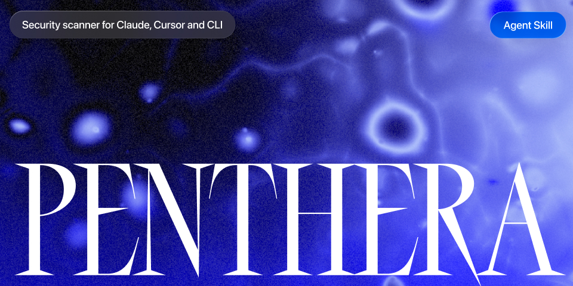
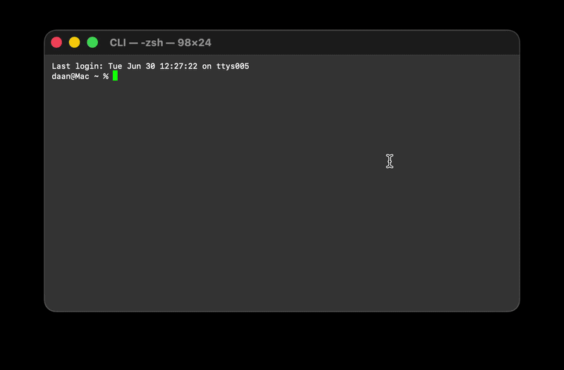
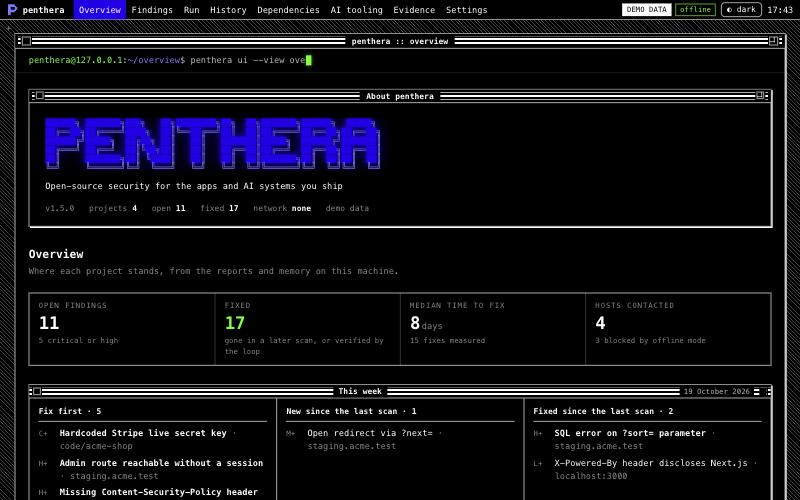
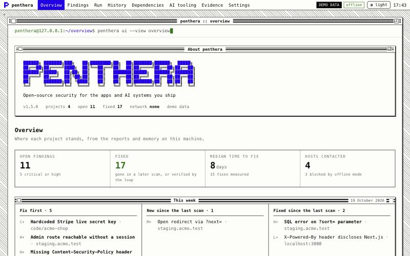
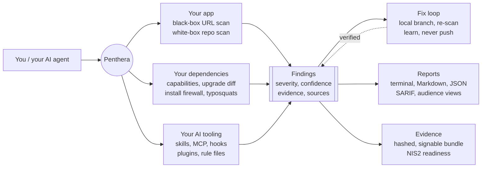

<div align="center">



<br/><br/>

[](https://www.npmjs.com/package/penthera)


[](https://github.com/danoszz/penthera/actions/workflows/ci.yml)
[](https://scorecard.dev/viewer/?uri=github.com/danoszz/penthera)

<br/>



</div>

---

<div align="center">

### Open-source security for the apps and AI systems you ship.

**Check it before you deploy. Vet what you build with. Keep watching after you
ship. On your own machine, offline, and free.**

</div>

---

## Try it in 60 seconds

No install, no account. Each step runs on your machine and sends nothing to us.

```bash
npx penthera agents --home          # 1. audit your Claude Code, Cursor and MCP setup
npx penthera deps                   # 2. what can the packages in this project actually do?
npx penthera http://localhost:3000  # 3. scan the app you are about to ship
```

Then read [who it is for](#who-it-is-for), or let your coding agent drive it
with the [Agent Skill](#run-it).

## The problem

Teams now ship apps and AI agents faster than anyone can secure them. AI writes
much of the code. AI pulls in the packages, MCP servers, and skills. And on most
teams nobody does security full time. Attackers have noticed: 2025 and 2026
brought self-spreading npm worms that hijacked AI coding tools, malicious MCP
servers, poisoned agent skills, and leaked AI provider keys running up large bills.

Commercial platforms answer this from the cloud, for a fee, often with an AI
deciding what is malicious. **Penthera answers it on your machine, for free,
with rules you can read.** Think of it as the open-source security team for
teams that don't have one.

## What it does for you

| | The job | What Penthera does | Command |
|---|---------|--------------------|---------|
| **Before you deploy** | Test the app | Scan your localhost or preview URL (TLS, headers, CORS, auth, JWT, IDOR, OAuth, OpenAPI, opt-in injection and fuzzing) and your repo (routes, trust boundaries, secrets including AI keys) | [`penthera <url> --repo .`](docs/commands/scan.md) |
| | Fix and verify | Deterministic fixes on a local branch, re-scanned to prove they worked, remembered so the next run is sharper. Never pushes | [`penthera agent --loop`](docs/commands/fix.md) |
| | Block it at commit time | Secrets, risky agent config, and dependency changes stopped before they are committed | [`penthera hook install`](docs/commands/hook.md) |
| **What you build with** | Vet dependencies | What every npm and Python package can actually do (install scripts, shell, network, env, obfuscation), what an upgrade added, lookalike names, licenses | [`penthera deps --base main`](docs/commands/deps.md) |
| | Guard installs | Shows what a new package brings before any install script runs, and stops it under your policy | [`penthera install <pkg>`](docs/commands/install.md) |
| | Review pull requests | Comments the dependency capability diff on every PR that touches the lockfile | [GitHub Action](docs/commands/action.md) |
| | Audit your AI tooling | Skills, MCP servers, hooks, plugins, and rule files: hidden instructions, unpinned servers, over-broad permissions, silent updates | [`penthera agents --home`](docs/commands/agents.md) |
| **After you ship** | Report and prove | Reports for developers, owners, and auditors; a hashed, signable evidence bundle; NIS2 and CRA readiness and report drafts | [`penthera <url> --audience auditor --evidence out/`](docs/evidence.md) |
| | See it all | A local dashboard on 127.0.0.1: where each project stands, findings in plain words, history, deps, AI tooling, evidence, and the fix loop with Apply / Skip / Stop per diff | [`penthera ui`](docs/dashboard.md) |
| | Keep watching | Scheduled checks of your own production for drift: certificates, headers, new endpoints, keys in bundles, new CVEs in your SBOM | *on the [roadmap](ROADMAP.md)* |

What it is not: a human pentester, a 24/7 SOC, or incident response. It does the
repeatable checks so the people you do have can spend their time on judgement.

## Who it is for

| You are | Start here |
|---|---|
| A solo founder or vibecoder about to launch | [Before launch](docs/use-cases/solo-founder.md) |
| A team adopting Claude Code or Cursor | [The AI-tooling supply chain](docs/use-cases/ai-coding-teams.md) |
| An open-source maintainer | [For maintainers](docs/use-cases/open-source-maintainers.md) |
| An EU SME with NIS2 or CRA duties | [Evidence for NIS2 and the CRA](docs/use-cases/eu-sme-compliance.md) |
| An agency shipping client apps | [A repeatable handover check](docs/use-cases/agencies.md) |

## Why you can trust it

- **Local and offline.** No account, no telemetry, no cloud. `--offline` limits
  network traffic to the target you named, and every report lists the hosts that
  were contacted.
- **Deterministic, not an AI verdict.** Rules you can read, with `file:line`
  evidence and a confidence label on every finding. No model decides what is
  malicious.
- **Never acts behind your back.** The fix loop works on a local branch, asks
  before every change by default, and never pushes or opens pull requests.
- **No update channel to hijack.** Detection rules ship inside reviewed releases.
  Nothing is downloaded and executed at run time.
- **Releases you can verify.** Published with npm provenance through trusted
  publishing, and each version is approved by a maintainer with 2FA before it
  goes live. SHA-pinned CI, CodeQL, and OpenSSF Scorecard.
- **Measured and cited.** A published [methodology](docs/METHODOLOGY.md),
  [48 verified references](docs/references.md), and a reproducible
  [benchmark](bench/RESULTS.md) with precision and recall.

## By the numbers

Penthera has no customer logos yet. Here is what can be checked instead.

| | |
|---|---|
| Benchmark, labelled local targets | precision 0.86, recall 0.90 (19 true positives, 3 false positives, 2 misses; [every one listed](bench/RESULTS.md)) |
| Detection rules, all readable | 14 URL scan templates, 20 secret and AI-key patterns, 15 dependency capabilities, 39 AI-tooling audit rules, 5 fix recipes |
| Tests | 687 in the suite, run on Node 22 and 24 on every push |
| Release gate | an [internal audit](docs/internal-audit.md) of 8 gates (tests, benchmark drift, self-scan, CLI smoke, packaging, offline egress, supply chain, docs links); [latest report](audit/REPORT.md) |
| Research | a [methodology](docs/METHODOLOGY.md) backed by [48 cited references](docs/references.md) |
| Supply chain of Penthera itself | [OpenSSF Scorecard](https://scorecard.dev/viewer/?uri=github.com/danoszz/penthera), SHA-pinned CI, CodeQL, npm provenance, each release staged and approved with 2FA |
| Network calls in `--offline` mode | only the target you named; the benchmark run made 0 requests to non-loopback hosts |

Counts as of 2026-10-19. Refresh them with `npm run docs:numbers` (add
`-- --tests` to count tests), `npm run bench` and `npm run audit:internal`. The benchmark targets are small and written
by the same people as the scanner, so they catch regressions rather than
measure real-world accuracy; see [its limits](bench/RESULTS.md#limits-of-these-numbers).

---

## How Penthera fits with other tools

Penthera is meant to sit next to the tools you already use. Its SARIF output
goes straight into GitHub code scanning, for example. Each comparison page says
where the other tool goes further and how to run the two together.

| | Focus | Where it runs | How it decides |
|---|---|---|---|
| **Penthera** | Your app, your dependencies, your AI tooling, fixes, EU evidence | Your machine or CI, offline | Readable deterministic rules, with evidence |
| [Socket](docs/compare/socket.md) | Supply-chain risk across package registries | Cloud service, GitHub App, CLI | Registry-scale package analysis, including AI review |
| [Snyk](docs/compare/snyk.md) | Known vulnerabilities in dependencies, code, containers, IaC | Cloud service, IDE, CLI | Curated vulnerability database plus static analysis |
| [GitHub Dependabot and code scanning](docs/compare/github.md) | Known-CVE alerts, update PRs, CodeQL | GitHub | Advisory database, CodeQL queries |
| [OWASP ZAP](docs/compare/zap.md) | Dynamic testing of web apps | Your machine or CI | Active and passive scan rules |
| [Semgrep](docs/compare/semgrep.md) | Static analysis of your own code | Your machine, CI, cloud platform | Pattern rules, plus a paid cross-file engine |

All comparisons: [docs/compare/](docs/compare/README.md). Corrections are welcome by pull request.

---

## Run it

**As an Agent Skill (recommended).** Let Claude Code, Cursor or [40+ other
agents](https://agentskills.io/clients) drive it, then ask "scan my app for
security issues", "is this package safe to add?", or "audit my MCP servers":

```bash
npx skills add danoszz/penthera
```

**As a CLI.** `npx penthera https://your-app.example`, or install it with the
one-line installer, which also links the skill into Cursor and Claude Code:

```bash
curl -fsSL https://raw.githubusercontent.com/danoszz/penthera/main/install.sh | bash
```

Run `penthera` with no arguments for a guided wizard. Other install routes
(Claude Code plugin, Claude.ai upload, per-project copy) are in
[docs/commands/skill.md](docs/commands/skill.md).

> The skill adds an authorization gate: it instructs your agent to refuse targets
> you do not own or are not authorized to test.

### What you get

```
  Findings

  HIGH  IDOR/BOLA: GET /api/users/{user_id}
         http://localhost:3000/api/users/1 → 200
  HIGH  OAuth open redirect
         http://localhost:3000/api/oauth/callback?redirect_uri=... → 302
  MED   Missing Content-Security-Policy
  MED   No login rate limiting detected
         http://localhost:3000/api/login → 401
  LOW   Missing X-Frame-Options
  INFO  Missing Referrer-Policy

  ──────────────────────────────────────────────────────────
  2 high · 5 medium · 2 low · 2 info
```

Every finding carries a confidence label (`confirmed`, `likely`, `potential`,
`needs-human-review`), so a heuristic never poses as a certainty. Reports come
out as Markdown, JSON, and SARIF, with the fixes in priority order.

## Commands

| Command | What it does | Details |
|---|---|---|
| `penthera <url> [--repo .]` | Black-box and white-box scan; `--profile quick\|standard\|deep` | [scan.md](docs/commands/scan.md) |
| `penthera agents [--home] [--pin]` | Audit skills, MCP servers, hooks, permissions, plugins, rule files; graded A to F | [agents.md](docs/commands/agents.md) |
| `penthera deps [--base main]` | Capabilities of every npm and Python package, upgrade diff, typosquats, `--license-policy` | [deps.md](docs/commands/deps.md) |
| `penthera install <pkg>` | Install firewall: review before any install script runs | [install.md](docs/commands/install.md) |
| `penthera fix --plan`, `penthera agent --loop` | Deterministic fixes as diffs; the local scan, fix, verify, learn loop | [fix.md](docs/commands/fix.md) |
| `penthera hook install` | Pre-commit hook on staged changes, about 0.1 to 0.5 s | [hook.md](docs/commands/hook.md) |
| `uses: danoszz/penthera@<sha>` | PR comment with the capability diff, plus SARIF | [action.md](docs/commands/action.md) |
| `penthera --machine` | macOS checks (persistence, keyloggers, rootkits) | [scan.md](docs/commands/scan.md) |
| `penthera ui [--open] [--demo]` | Local dashboard on 127.0.0.1; runs scans and the fix loop from the page | [dashboard.md](docs/dashboard.md) |

Scans, `agents` and `deps` write Markdown, JSON and SARIF (`--markdown`,
`--json`, `--sarif`). Exit code `1` means critical or high findings, `2` means
the scan failed.

| `penthera ui`, dark | `penthera ui`, light |
|---|---|
|  |  |

## How it works



Findings map to the [OWASP Web Security Testing Guide](docs/owasp-wstg-coverage.md)
(WSTG v4.2), and agent findings to the OWASP MCP and Agentic Top 10s. The
default scan is non-destructive. Payload-based testing is opt-in (`--deep`,
`--fuzz`, `--all`) and gated behind explicit confirmation.

---
## Compliance: NIS2 and the CRA

Shipping in the EU? NIS2 (the Cyberbeveiligingswet in the Netherlands, the
NIS2-wet in Belgium) puts a duty of care on in-scope organisations, and the
Cyber Resilience Act adds reporting duties for products with digital elements.
Penthera turns the technical, testable part into repeatable evidence: an
Article 21(2) coverage table (`--framework nis2`), a readiness report, policy
templates, incident and CRA Article 14 report drafts with deadlines, a CycloneDX
SBOM and AI-BOM, and prefilled customer questionnaires. Offline, no accounts.
Guides: [NIS2](docs/compliance-nis2.md) and [CRA](docs/compliance-cra.md).

> Readiness tooling, not a certification and not legal advice.

---

## Ethical use & authorization

Penthera sends HTTP requests to the targets you give it. Some modes (`--deep`,
`--fuzz`, `--all`) send attack payloads designed to find vulnerabilities. Use it
responsibly.

**You may use Penthera when:**

- You **own** the target (your app, your server, your project).
- You have **written authorization** from the system owner (email, ticket, signed scope).
- You scan **localhost** or private lab environments you control.
- You use it for **defensive security**: research, coursework, CI hardening, pre-release audits.

**You must not use Penthera to:**

- Scan systems you do not own or lack explicit permission to test.
- Probe government, healthcare, financial, or third-party production systems without authorization.
- Exfiltrate data, disrupt services, or bypass access controls.
- Use findings to attack, extort, or harm anyone.

> Before scanning any URL that is not localhost, confirm you have permission.
> **When in doubt, do not scan.**

Unauthorized security testing may violate computer-misuse laws (for example the US
CFAA, the UK Computer Misuse Act, and EU national equivalents) and can result in
criminal prosecution, civil liability, IP blocking, account termination, and
academic or professional penalties.

---

## Install

Requirements: Node.js 22+ and npm. To install from source:

```bash
git clone https://github.com/danoszz/penthera.git
cd penthera && npm install && npm link   # exposes `penthera` globally
```

Or in a container: `docker build -t penthera . && docker run --rm penthera https://your-app.example`.

## Testing and contributing

```bash
npm test                 # full suite (live integration tests skip without a running target)
npm run pentest:mock     # offline tests against a local mock vuln API
npm run bench            # precision and recall on labelled local targets
```

How Penthera decides what is a finding, how sure it is, and what it cannot see
is in [docs/METHODOLOGY.md](docs/METHODOLOGY.md), with every design choice tied
to a [reference](docs/references.md). See [CONTRIBUTING.md](CONTRIBUTING.md) for
the project layout and release checklist, and the [roadmap](ROADMAP.md) for what
is next. To cite Penthera, use the "Cite this repository" button on GitHub
([CITATION.cff](CITATION.cff)).

## Status

App scanning (URL, repo, macOS machine), dependency capability analysis and an
install firewall, the AI-tooling audit, the local fix loop with a learning
store, audience reports and evidence bundles, the PR-comment GitHub Action, the
pre-commit hook, and NIS2 and CRA readiness tooling are all shipped. See the
[CHANGELOG](CHANGELOG.md) for the history. Issues and PRs welcome.

---

## Support Penthera

Penthera is free and MIT-licensed. If it caught something before you shipped it,
you can help keep it maintained:

[](https://github.com/sponsors/danoszz)

| Tier | Monthly | You get |
|------|---------|---------|
| Individual | $5 | Thanks, and your name on the GitHub sponsors list |
| Supporter | $25 | A mention in the next release notes |
| Startup | $100 | Your name and link in this README |
| Company | $500 | Your logo in this README, and a quarterly roadmap call |

Sponsorship pays for maintainer time: keeping detection rules current, security
fixes, and the [roadmap](ROADMAP.md). It does not buy influence over findings,
a support SLA, or early access to vulnerability reports, and a logo here is not
a security endorsement of that company. Details in
[docs/funding/sponsor-tiers.md](docs/funding/sponsor-tiers.md).

---

## Privacy

Penthera has no telemetry and does not phone home. Scan traffic goes to the
target you name, reports stay on your machine, and every scan lists any
third-party host it contacted. With `--offline` the HTTP client refuses every
host except the target. Which hosts a normal scan may contact, and why, is in
[docs/privacy.md](docs/privacy.md).

---

## Disclaimer

Penthera is provided for legitimate security research and defensive testing of
systems you own or are authorized to test, and for that purpose only.

- It is a research and self-assessment tool. Scan your own apps to find and fix
  weaknesses before attackers do.
- The same capabilities that harden a system can cause harm if pointed at someone
  else's. Use it carefully and lawfully.
- The author does not condone unauthorized or malicious use, and accepts no
  liability for any damage, loss, or legal consequence arising from use or misuse
  of this software.
- The software is provided "as is", without warranty of any kind. See [LICENSE](LICENSE) (MIT).
- You are solely responsible for ensuring every scan you run is authorized and
  legal in your jurisdiction.

By using Penthera you accept these terms.

---

## License & disclosure

MIT. See [LICENSE](LICENSE). Report vulnerabilities in Penthera itself via
[SECURITY.md](SECURITY.md). Only scan systems you own or are authorized to test.
