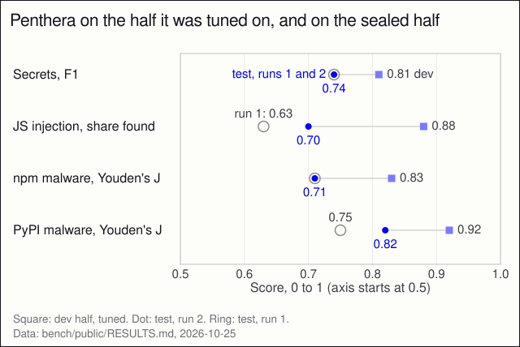

> How do you benchmark your own security tool against other tools without fooling yourself?

On {{fact:date}} we published four rankings. Each puts Penthera next to every free, open-source tool we could run offline on one public dataset, scored the same way, on a half of the dataset we sealed before any tuning. Penthera ranked {{fact:npm.penthera.place}} of {{fact:npm.of}} on malicious npm packages (tied {{fact:npm.penthera.interval}}) and {{fact:pypi.penthera.place}} of {{fact:pypi.of}} on malicious PyPI packages (tied {{fact:pypi.penthera.interval}}). On injection bugs in JavaScript libraries it ranked {{fact:library.penthera.place}} of {{fact:library.of}}, tied {{fact:library.penthera.interval}}, within the margin of error of ODGen. On leaked secrets it ranked {{fact:secrets.penthera.place}} of {{fact:secrets.of}}, behind deepsecrets.

A tied range is a rank interval. We redrew each tool's results 10,000 times from its counts (on SecBench.js, by resampling the bugs) and kept the middle 95% of the ranks Penthera got. On npm it alone came out first in {{fact:npm.penthera.first}} of the draws, on PyPI in {{fact:pypi.penthera.first}}, on SecBench.js in {{fact:library.penthera.first}}. We did this after the registered ranking, so it is exploratory.

This post is about how we got those numbers and how far you should trust them. Every tool, interval and limit is on [the benchmark pages](/benchmarks).

## Why a sealed half

The easy way to improve a scanner on a benchmark is to look at what it misses and write rules for those cases. The score goes up. It also means less, because the rules now know the answers.

So we split each dataset in half before anyone looked at a single error. The split is seeded (seed 20261024), stratified and 50/50. It was committed as a list of ids and hashes before either half was scored. We tuned on the dev half only. The test half was scored once, at the end, and only its numbers are published. The runner refuses to score the test half without a flag that says it is the final run.

## Rules written before the run

Before the test half was read, we registered how each benchmark ranks:

- Secrets by F1, the balance of precision and recall.
- Malware by Youden's J: the share of malicious packages caught minus the share of benign packages flagged.
- SecBench.js by the share of bugs found in the right file.

A rank needs at least five other free tools measured on the same half. A tool trained on the dataset is shown and not ranked. That rule took out CredSweeper, which scored F1 {{fact:secrets.credsweeper.score}}: it is made by the CredData authors, and its model was trained on CredData. A lookup of already-reported packages is shown and not ranked too, so osv-scanner is not in the malware ranks.

## What a change could be based on

Every improvement had to be a general pattern, stated in words, such as "YAML values are unquoted". Never a file name, a package name or a value from a dataset. Each change got unit tests from our own fixtures, not from dataset content. After tuning, a reviewer who did not write the rules checked every rule and test added since 1.9.0. They found no dataset identifiers, values or package names, and no added indicator of compromise.

## What we found

- **Malicious npm packages.** Penthera caught {{fact:npm.penthera.detect}} packages with a payload ({{fact:npm.penthera.r}}, 95% CI {{fact:npm.penthera.detectCI}}) and flagged {{fact:npm.penthera.benign}} benign packages. Score {{fact:npm.penthera.score}}; next, malcontent with {{fact:npm.malcontent.score}}.
- **Malicious PyPI packages.** Score {{fact:pypi.penthera.score}}; next, GuardDog with {{fact:pypi.guarddog.score}}. Penthera's false-alarm rate was {{fact:pypi.penthera.fa}} (95% CI {{fact:pypi.penthera.benignCI}}). We had set a target of 0.03 and missed it.
- **Injection bugs in JavaScript libraries.** Penthera found {{fact:library.penthera.pooled}} ({{fact:library.penthera.score}}, 95% CI {{fact:library.penthera.pooledCI}}); ODGen found {{fact:library.odgen.pooled}} ({{fact:library.odgen.score}}, 95% CI {{fact:library.odgen.pooledCI}}). The intervals overlap almost entirely. Read it as a tie.
- **Leaked secrets.** deepsecrets scored F1 {{fact:secrets.deepsecrets.score}} and Penthera {{fact:secrets.penthera.score}}. Penthera has higher precision ({{fact:secrets.penthera.p}} against {{fact:secrets.deepsecrets.p}}) and lower recall ({{fact:secrets.penthera.r}} against {{fact:secrets.deepsecrets.r}}).

For scale: Penthera 1.9.0, before the study, scored {{fact:secrets.penthera-before.score}} on secrets and {{fact:library.penthera-before.score}} on SecBench.js on the same test half.

## The drop from dev to test

On the dev half, after tuning, Penthera scored higher on every benchmark than it then did on the sealed half: secrets F1 0.81 to 0.74, SecBench.js 0.88 to 0.70, npm 0.83 to 0.71, PyPI 0.92 to 0.82. That gap is what tuning on the data you score looks like. It is the reason for the split.

Penthera on the dev half it was tuned on and on the sealed half, one row per benchmark, with both test runs. The axis starts at 0.5. Drawn by `blog/figures/make.mjs` from RESULTS.md.

## Two test runs, both reported

The first final run was stopped before anyone read it, when we decided on one more round of tuning. Its outputs were packed into one archive, its hash recorded and every readable copy deleted. After round two we opened it and published both runs, so neither was picked after the fact. Secrets and npm scored the same in both. PyPI went from 0.75 to 0.82 and SecBench.js from 0.63 to 0.70. Penthera 1.9.0 scored the same in both runs, so the harness is deterministic.

## The leaks the audit found

The same review found two leaks in the split itself:

- CredData is split by file, so 318 of 329 test repositories also have files on the dev side. Removing the one repository the reviewer flagged moves F1 from 0.742 to 0.738.
- SecBench.js had four packages on both halves. Without them, command injection is 0.77 instead of 0.74.

A clean measure needs new data: malware samples published after the freeze, and real projects.

## What this does not show

- The free tools ran on their defaults. Penthera was tuned on the other half of each dataset.
- CredData replaces real secrets with look-alikes. That favours pattern rules over tools that verify a key with its provider, and trufflehog ran with verification off.
- GuardDog's authors helped build the malware dataset, so its catch rate there is inflated by construction.
- Paid tools ({{fact:paid}}) publish no results on these datasets, and we cannot measure them.
- A benchmark is not your code. Accuracy on real projects is experiment E1, pre-registered and not yet run.

## Method and sources

- **Datasets.** Leaked secrets: Samsung CredData (Yun et al., 2021). Injection bugs: SecBench.js (Bhuiyan et al., 2023). Malicious packages: Datadog's dataset of malicious npm and PyPI packages (Datadog Security Labs, 2023). ODGen is the tool of Li et al. (2022).
- **Scores.** Youden's J comes from the evaluation of diagnostic tests (Youden, 1950). Intervals on a single rate are 95% Wilson intervals (Wilson, 1927). The rank intervals come from a parametric bootstrap (Efron, 1979), run after the registered analysis.
- **Why a split.** Scoring a tool on the data it was tuned on is a form of leakage, and leakage inflates results (Kapoor & Narayanan, 2023). Writing the ranking rules down before the test half is read follows the logic of preregistration (Nosek et al., 2018).
- **Figure.** The plot under "The drop from dev to test" is drawn by `blog/figures/make.mjs` from RESULTS.md ([the SVG](https://github.com/danoszz/penthera/blob/main/blog/figures/dev-to-test.svg)).

## Check it yourself

- Every number: [published.json](https://github.com/danoszz/penthera/blob/main/bench/public/published.json), shown with every tool on [penthera.org/benchmarks](/benchmarks).
- The protocol, written before the run: [E11b](https://github.com/danoszz/penthera/blob/main/docs/research/prereg/E11b-improvement-study.md).
- Try it on your own repo: `npx penthera@{{fact:secrets.penthera.version}} --repo .`
- Rerun the benchmark: the commands, requirements and dataset versions are in [bench/public/README.md](https://github.com/danoszz/penthera/blob/main/bench/public/README.md#reproduce). The protocol was approved at commit `262745c`, and the final run was on `219b73a`.

## References

Bhuiyan, M. H. M., Parthasarathy, A. S., Vasilakis, N., Pradel, M., & Staicu, C.-A. (2023). SecBench.js: An executable security benchmark suite for server-side JavaScript. In *2023 IEEE/ACM 45th International Conference on Software Engineering (ICSE)* (pp. 1059–1070). IEEE. [https://doi.org/10.1109/ICSE48619.2023.00096](https://doi.org/10.1109/ICSE48619.2023.00096) ([entry](https://github.com/danoszz/penthera/blob/main/docs/references.md#bhuiyan2023secbenchjs))

Datadog Security Labs. (2023, March 20). *Open-source dataset of malicious software packages*. GitHub. Retrieved October 29, 2026, from [https://github.com/datadog/malicious-software-packages-dataset](https://github.com/datadog/malicious-software-packages-dataset) ([entry](https://github.com/danoszz/penthera/blob/main/docs/references.md#datadog2023malicious))

Efron, B. (1979). Bootstrap methods: Another look at the jackknife. *The Annals of Statistics*, *7*(1), 1–26. [https://doi.org/10.1214/aos/1176344552](https://doi.org/10.1214/aos/1176344552) ([entry](https://github.com/danoszz/penthera/blob/main/docs/references.md#efron1979bootstrap))

Kapoor, S., & Narayanan, A. (2023). Leakage and the reproducibility crisis in machine-learning-based science. *Patterns*, *4*(9), Article 100804. [https://doi.org/10.1016/j.patter.2023.100804](https://doi.org/10.1016/j.patter.2023.100804) ([entry](https://github.com/danoszz/penthera/blob/main/docs/references.md#kapoor2023leakage))

Li, S., Kang, M., Hou, J., & Cao, Y. (2022). Mining Node.js vulnerabilities via object dependence graph and query. In *31st USENIX Security Symposium (USENIX Security 22)* (pp. 143–160). USENIX Association. [https://www.usenix.org/conference/usenixsecurity22/presentation/li-song](https://www.usenix.org/conference/usenixsecurity22/presentation/li-song) ([entry](https://github.com/danoszz/penthera/blob/main/docs/references.md#li2022odgen))

Nosek, B. A., Ebersole, C. R., DeHaven, A. C., & Mellor, D. T. (2018). The preregistration revolution. *Proceedings of the National Academy of Sciences*, *115*(11), 2600–2606. [https://doi.org/10.1073/pnas.1708274114](https://doi.org/10.1073/pnas.1708274114) ([entry](https://github.com/danoszz/penthera/blob/main/docs/references.md#nosek2018preregistration))

Wilson, E. B. (1927). Probable inference, the law of succession, and statistical inference. *Journal of the American Statistical Association*, *22*(158), 209–212. [https://doi.org/10.1080/01621459.1927.10502953](https://doi.org/10.1080/01621459.1927.10502953) ([entry](https://github.com/danoszz/penthera/blob/main/docs/references.md#wilson1927probable))

Youden, W. J. (1950). Index for rating diagnostic tests. *Cancer*, *3*(1), 32–35. [https://doi.org/10.1002/1097-0142(1950)3:1%3C32::AID-CNCR2820030106%3E3.0.CO;2-3](https://doi.org/10.1002/1097-0142(1950)3:1%3C32::AID-CNCR2820030106%3E3.0.CO;2-3) ([entry](https://github.com/danoszz/penthera/blob/main/docs/references.md#youden1950index))

Yun, J., Choi, S., Lee, Y., Sokol, O., Shim, W., Melkonyan, A., & Kuzmenko, D. (2021). *Project CredData: A dataset of credentials for research*. GitHub. Retrieved October 29, 2026, from [https://github.com/Samsung/CredData](https://github.com/Samsung/CredData) ([entry](https://github.com/danoszz/penthera/blob/main/docs/references.md#yun2021creddata))

## Changes

- 2026-10-28: published.
- 2026-10-29: added the method and sources, the figure link, the rerun link and the references. No claim or number changed.
